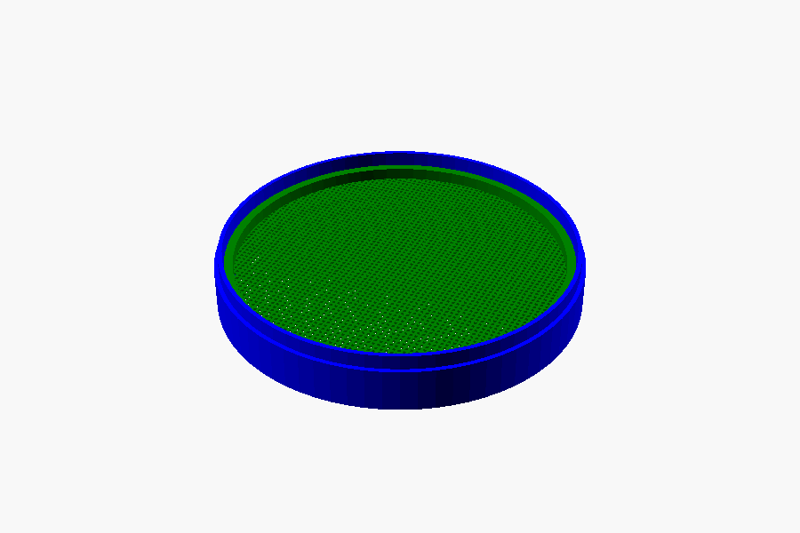

# screw-sorter

A stack of 3D-printed sieves for sorting a jumble of screws by size. Each
tray is a round sieve with a different hole size; a holder ring sits between
trays so they stack, coarsest on top. Shake the stack and each screw stops on
the first tray whose holes it can't pass through.

Made out of dire need, in OpenSCAD.

## Make one

Open `screw_sorter.scad` in OpenSCAD and use the Customizer:

- **Render control**: `sieve` for a tray, `holder` for a ring, `all` for both.
- **Gap size**: the hole size, which sets what passes through.
- **Outer diameter**, **strand width and height**, **rim thickness and
  height**, **taper**: the tray itself.
- **Holder allowances**: the clearances between a tray and its holder, and
  between holders, so they fit after printing.

The sorter is round only. `examples/sieve.scad` and `examples/holder.scad`
render the default tray and holder.

## Printing a set

`just batch` renders the set printed in 2025 into `batch/`: ten 120 mm trays
with gaps of 1 mm to 10 mm, and the holder. They were printed on a Prusa XL
with a 0.4 mm nozzle, five trays to a plate, in PrusaSlicer 2.9.0:

- profile: 0.10mm FAST DETAIL @XLIS 0.4
- filament: Generic PLA, 220 °C, bed 60 °C
- 0.1 mm layers, 3 perimeters, 7 bottom and 8 top solid layers
- 15 % grid infill; supports off for the trays, on for the holder

`prints/` holds the first test prints from January 2025: three trays with
3, 5 and 8 mm gaps and a holder, with their PrusaSlicer projects. They came
from an earlier version of the design that is no longer in this repository,
so they don't match what `screw_sorter.scad` renders now.

## How it's built

The trays come from a customizable sieve by DrLex, kept in
[`lib/sieve.scad`](lib/sieve.scad) with two additions for this sorter: a
stacking rim on the sieve, and `stackable_sieve_holder()`, the ring that holds
one tray and stacks on the next. The library is included here so the sorter
needs nothing else installed.

## Licence and credit

[CC BY-SA 4.0](LICENSE), the terms of the sieve this is built on.

- **Sieve**: [Customizable sieve](https://github.com/DrLex0/print3D-customizable-sieve)
  by DrLex (Alexander Thomas) and contributors, formerly Thingiverse
  thing:2578935, itself based on
  [Sieve by pcstru](https://www.thingiverse.com/thing:341357).
- **Stacking rim, holder and sorter**: Cameron K. Brooks.
